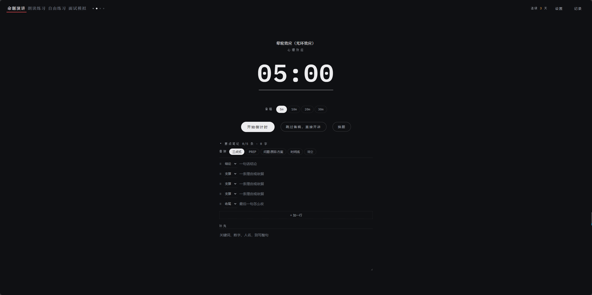
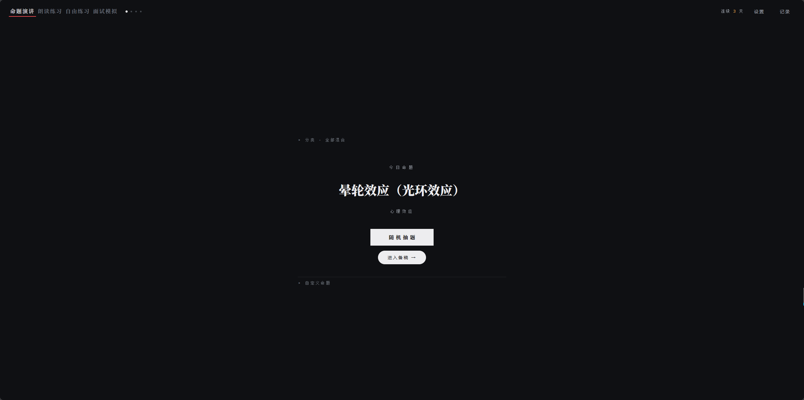
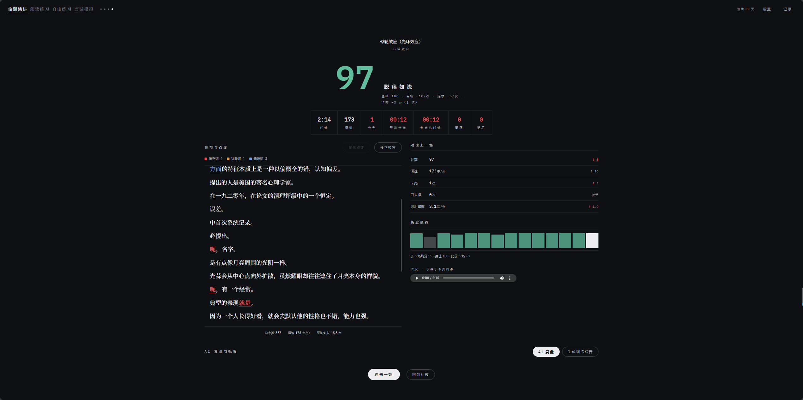
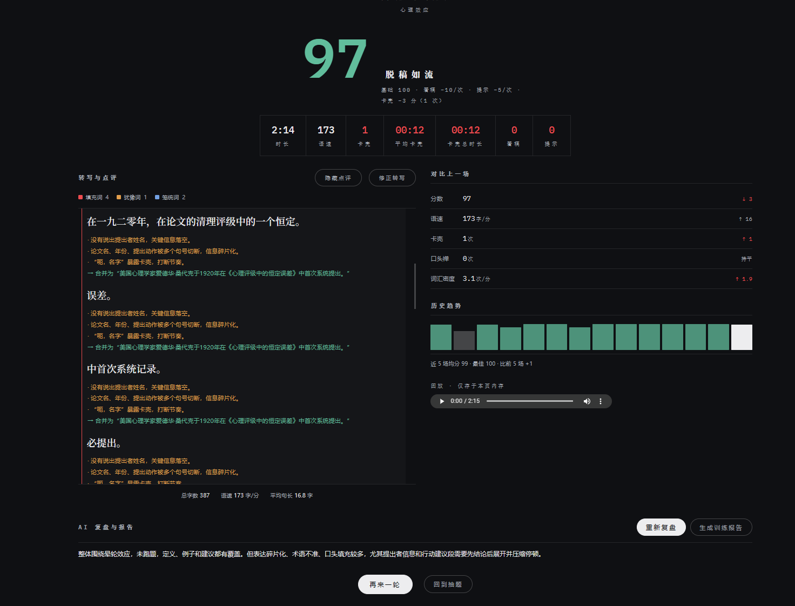
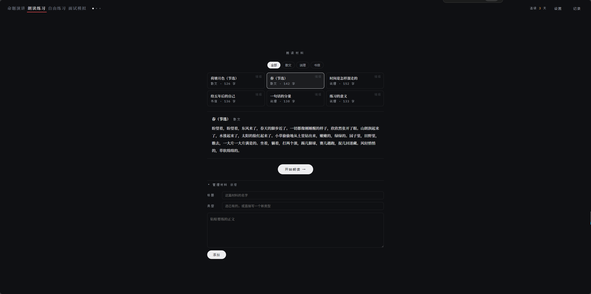
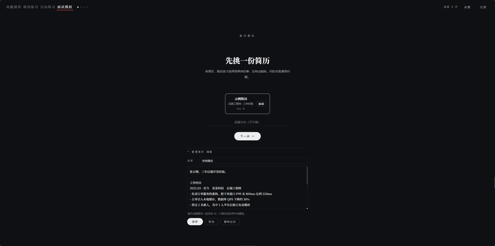
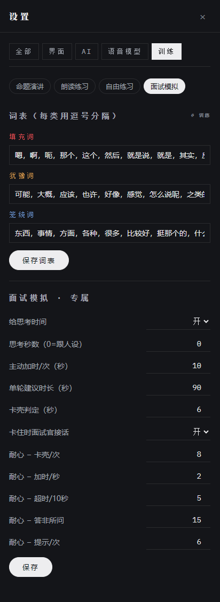
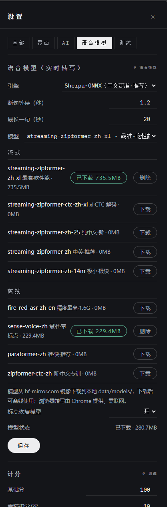

# 表达训练场 · extemp-trainer

一个**本地部署的表达训练器**，目前有四个模式：**命题演讲**（随机抽题 → 限时备稿 → 脱稿开讲）、**朗读练习**（选一篇文章 → 照着读 → 逐字比对漏读 / 错读 / 多读 / 重复）、**自由练习**（随便说，不评分，只做一次表达体检）与**面试模拟**（挑简历 → 选面试官 → 多轮问答，面试官会追、会施压、有耐心）。本地语音模型实时转写字幕，AI 教练按模式点评，结束后统计并生成一份可留存的 Markdown 训练报告。

- 🔒 **隐私优先**：语音只在内存中处理，不落盘、不上传；API Key 只存在本机配置文件
- 🖥️ **纯本地运行**：FastAPI 单体服务 + 原生单页前端，无需数据库、无需 Node 构建
- 🧩 **多模式架构**：模式只声明阶段序列与自己的输入 / 结算规则，开讲、转写、历史、AI 全部共用
- 🎙️ **多语音引擎**：浏览器转写 / faster-Whisper / sherpa-onnx（9 款中文模型，流式边说边出字）
- 🤖 **兼容任意 OpenAI 协议大模型**：DeepSeek、通义、Kimi、OpenAI 等填个地址就能用

---

## 目录

- [功能特性](#功能特性)
- [训练模式](#训练模式)
- [界面预览](#界面预览)
- [训练流程](#训练流程)
- [快速开始](#快速开始)
- [语音引擎与模型](#语音引擎与模型)
- [AI 教练配置](#ai-教练配置)
- [项目结构](#项目结构)
- [HTTP / WebSocket 接口](#http--websocket-接口)
- [配置文件说明](#配置文件说明)
- [数据目录与隐私](#数据目录与隐私)
- [技术栈](#技术栈)
- [常见问题](#常见问题)

---

## 功能特性

| 模块 | 说明 |
|---|---|
| 题库系统 | 内置观点思辨 / 职场汇报 / 生活叙事 / 知识讲解 / 认知思维 / 心理洞察 6 大类约 90 道命题；支持增删改、YAML 导入（合并 / 替换）与导出。自拟命题可直接归到任意分类，也能在列表里随时改分类或新建分类 |
| 限时备稿 | 多档备稿时长（1/5/10/20/30 分钟），时间到自动进入开讲倒计时，也可随时手动开始 |
| 实时转写 | WebSocket 推送 PCM 音频，VAD 自动断句，流式模型逐字出字幕；支持暂停 / 继续（暂停期间不计时长与语速） |
| 朗读材料 | 内置 6 篇（散文 / 说理 / 书信），可自己新增、编辑、删除，类型随便写——分类就是材料上的一个字段，写个新的就等于新建一类 |
| 朗读练习 | 照着材料读一遍即给出完整度、准确率与漏读 / 错读 / 多读 / 重复；开讲页原文随读到哪标记到哪，结算页把漏读位置标红 |
| 脱稿计分 | 基础分 100，「看稿」一键记录并扣分；看稿以"纸条"形式限时展示，模拟真实脱稿压力 |
| 词汇统计 | 填充词 / 犹豫词 / 笼统词三类自定义词表，统计次数、每分钟频次、高频口头禅 Top3、语速、平均句长，结算页逐词高亮 |
| 实时教练 | 讲述过程中每出一句定稿，AI 立即针对该句给问题与改法（可配置每几句点评一次以节省 token） |
| 赛后复盘 | AI 对全文逐句分析（重复、削弱表达、结构、跑题），挑出最好 / 最差句子，生成 400–600 字 Markdown 报告并本地存档 |
| 历史记录 | 全部训练记录保存在本机，可回看任意一场的字稿、统计与报告，支持单条删除与一键清空 |
| 界面定制 | 三套预设主题（carbon 深色 / paper 纸白 / forest 墨绿）+ 自定义配色，字幕与教练字号可调 |

## 训练模式

页头左侧切换。四个模式的开讲、转写、实时统计、AI 复盘、历史存储是同一套引擎，
差别只在「练什么」和「怎么算分」。

| | 命题演讲 `extemp` | 朗读练习 `read` | 自由练习 `free` | 面试模拟 `interview` |
|---|---|---|---|---|
| 阶段 | 抽题 → 备稿 → 开讲 → 结算 | 选材料 → 开讲 → 结算 | 起个头 → 开讲 → 结算 | 挑简历 → 选人设 → 多轮问答 → 结算 |
| 输入 | 题库命题 + 备稿提纲（设置里可增删改、YAML 导入导出） | 材料库文章（`data/articles.yaml`，选材料页直接增删改 + 改类型） | 可以填个主题，也可以空着直接说 | 简历（`data/resumes.yaml`）+ 面试官人设 |
| 开讲页 | 无原文，可记看稿 | 上方常驻原文，读到的字变暗、当前落点高亮 | 无原文、无扣分按钮、无当前分 | 上方是对话流：面试官提问 + 你的回答，右侧耐心条 |
| 扣分 | 看稿、提示、卡壳 | 漏读（1/字，上限 40）、错读（0.5/处，上限 30）、重复（2/次，上限 20） | **不评分** | 五维打分：针对性 / 结构 / 证据 / 时长 / 清晰度 |
| 结算指标 | 时长 / 语速 / 卡壳 ×3 / 看稿 / 提示 | 时长 / 完整度 / 准确率 / 漏读 / 错读 / 多读 / 重复 | 时长 / 语速 / 字数 / 卡壳 / 平均卡壳 | 五维分 + 耐心剩余 |
| AI 关注 | 结构、说服力、脱稿表达 | 漏读、错读、重复 | 结构 / 清晰 / 啰嗦 / 逻辑 / 语气 的表达毛病 + 改进方向 | 答得准不准、有没有 STAR、有没有具体数字 |
| 结算视图 | 字稿内联点评 | 字稿内联点评 + 原文比对（漏读标红） | 字稿内联点评 | 字稿内联点评 + 按轮复盘 |

历史、趋势与「对比上一场」全部**限定在同一模式内**——命题演讲的分数和朗读的分数不是一回事，跨模式比会得出错误结论。
自由练习不评分：成绩位显示「—」，场次照常累计，但**均分和最佳只统计有分数的场次**。

### 面试模拟的几个特别之处

- **没有固定的问答轮数**。问多久由面试官决定（它觉得看清楚了你就会收尾），
  你也可以随时点「结束面试」；耐心归零会被提前赶出去，总分打六折
- **面试官有耐心**。卡壳、主动讨要思考时间、单轮超时、答非所问都会掉耐心；
  耐心低了语气转冷、追问变硬
- **面试官可以增删改**。4 套内置人设是种子，面试设置页的「管理面试官」里能改
  风格 / 耐心 / 思考秒数 / 单轮上限 / 会不会打断，也能新建自己的面试官
- **开场白可以写死**（填在人设里），不写就由 AI 现场生成；开场白也会当作
  已经问过的问题记进历史，不会被追问重复
- **思考时间由面试官给**（HR 15 秒、压力面 8 秒），可以主动加时，代价是掉耐心
- **卡太久面试官会自己接话**（追问 / 换角度 / 施压），不用你干等着
- **简历只读一次**，压成摘要 + 疑点清单，之后每轮追问都追这些疑点——这也是真实面试官的做法
- 面试模式**必须有 AI**：没配 AI 就没有面试官，进不去
- 提示词里写死了「不评判内容真伪」——AI 不知道你的经历是不是真的，只评这段回答讲得像不像个好答案

## 界面预览

**命题演讲**：抽题备稿 → 开讲实时字幕 → 结算与 AI 逐句点评

| 抽题与限时备稿 | 开讲：实时字幕 |
|---|---|
|  |  |

| 结算总览 | 结算 · AI 逐句点评 |
|---|---|
|  |  |

**朗读练习**：



**面试模拟**：

| 挑选简历 | 面试官与面试设置 |
|---|---|
|  |  |

**设置 → 语音模型**（推荐组合见[下节](#语音引擎与模型)）：



## 训练流程

```
命题演讲：抽题（分类/随机/自拟命题）     朗读练习：选一篇材料      自由练习：填个主题（可空）
   │                                        │                        │
   ▼                                        │                        │
限时备稿 ──► 开讲准备倒计时（可跳过）        │                        │
   │                                        │                        │
   ▼                                        ▼                        ▼
开讲 ── 麦克风 → WebSocket → 本地 ASR → 实时字幕
   │           ├─ 看稿 / 提示 计数扣分（命题演讲）
   │           ├─ 原文读到的位置实时标记（朗读）
   │           ├─ AI 逐句即时点评
   │           └─ 暂停 / 继续
   ▼
结算复盘 ── 词汇画像 + 逐句分析 + AI Markdown 报告 → 存入历史
```

## 快速开始

### 环境要求

- **Python 3.11+**（代码使用标准库 `tomllib`）
- Windows / macOS / Linux（启动脚本为 Windows `.bat`，其他系统见下方手动命令）
- 可选：Chrome / Edge 浏览器（使用「浏览器转写」引擎时需要 Web Speech API 支持）

### 1. 安装依赖

```bash
cd backend
python -m venv venv

# Windows
venv\Scripts\pip install -r requirements.txt -i https://mirrors.aliyun.com/pypi/simple/
# macOS / Linux
# venv/bin/pip install -r requirements.txt
```

依赖中已包含 `sherpa-onnx` 中文语音引擎与 `faster-whisper`；语音模型本体不随仓库分发，启动后在应用内按需下载。

### 2. 启动服务

**Windows**：直接双击项目根目录的 `启动.bat`，脚本会自动检测虚拟环境、检查 8642 端口占用并打开浏览器。

**手动启动（全平台）**：

```bash
# 在项目根目录
python -m uvicorn main:app --host 0.0.0.0 --port 8642 --app-dir backend
```

然后浏览器打开 **http://localhost:8642** 。

> 首次打开会在 `backend/data/` 下自动生成默认配置 `config.toml`、题库 `bank.yaml` 与词表 `words.yaml`。
> 语音模型不随仓库分发，需在应用内「设置 → 语音模型」中按需下载（详见下节）。

## 语音引擎与模型

在「设置 → 语音模型」中选择，四种引擎可随时切换：

| 引擎 | 中文效果 | 硬件 | 模型体积 | 实时性 | 说明 |
|---|---|---|---|---|---|
| 无（只计分） | — | 无 | 无 | — | 不转写，仅计分与录音回放 |
| 浏览器转写 | 一般，因浏览器而异 | 无 | 无需下载 | 真实时 | 走 Web Speech API，Chrome/Edge 中文尚可 |
| Whisper 本地 | small 尚可，large 好 | small+ 建议 GPU | 75 MB – 3 GB | 延迟 1–3 秒 | faster-whisper，tiny/base/small/medium/large-v3 |
| **sherpa-onnx** | **中文最优** | CPU 可跑 | 30 MB – 1.6 GB | 流式逐字 / 离线整段 | 中文模型池，推荐首选 |

sherpa-onnx 模型池（均在应用内一键下载，支持断点续传）：

- **流式（边说边出字）**：**xlarge 高精度版（736 MB，`streaming-zipformer-zh-xl`，推荐首选）**、纯中文 CTC xlarge（728 MB，同级精度更省算力）、双语 Zipformer（中英夹杂，190 MB）、2025 纯中文新版（160 MB）、14M 低配极速版（30 MB）等
- **离线（整段转写）**：SenseVoice（230 MB，自带标点）、Paraformer（232 MB，快而准）、FireRedASR（1.6 GB，公开中文基准 CER 最低，适合赛后精转）
- **标点恢复（推荐开启）**：CT-Transformer（281 MB），为流式模型的输出补逗号、问号，而非每句无脑加句号

下载源默认走国内镜像 `https://hf-mirror.com` 并禁用 Xet 协议（见 [speech.py](backend/speech.py) 开头的环境变量设置），无需额外网络配置。

**断句调节**：设置中的「断句等待」控制静音多久算一句话说完；「最长一句」控制连续说话不被打断的上限（到点强制断句，不看停顿）。

### 推荐配置

| 配置项 | 推荐值 | 说明 |
|---|---|---|
| 引擎 | sherpa-onnx | 中文效果最好，CPU 可跑流式 |
| 流式模型 | `streaming-zipformer-zh-xl` | 736 MB xlarge，中文准确率最高；纯中文且 CPU 紧张可选 CTC 版 `streaming-zipformer-ctc-zh-xl`；低配机器退回 160 MB 的 `streaming-zipformer-zh-25` |
| 标点恢复 | **开启**（先下载 CT-Transformer，281 MB） | 流式输出自动补逗号、问号等，而不是每句无脑加句号 |
| 断句等待 | **800 ms** | 说话快可降到 600 ms；边想边说、停顿多可升到 1000–1200 ms |
| 最长一句 | **25 秒** | 常说长复句可调到 30–60 秒，避免话没说完被强制断句 |

即：**`streaming-zipformer-zh-xl` + 开启标点恢复 + 断句等待 1.5 秒  + 最长一句 25 秒**。
断句参数先按推荐值起步，再根据自己的语速和停顿习惯微调：句子经常在半句就被切开 → 调大「断句等待」；连贯说话也被加句号 → 调大「最长一句」。

## AI 教练配置

实时点评与赛后报告为可选项，不配置也能完成转写、计分与词汇统计。

在「设置 → AI」中填写任意 **OpenAI 兼容接口**：

| 配置项 | 示例值 |
|---|---|
| Base URL | `https://api.deepseek.com`（也支持通义 / Kimi / 本地 Ollama 等兼容地址） |
| API Key | 你的密钥，仅写入本机 `backend/data/config.toml` |
| Model | 如 `deepseek-flash`；接口支持时可在界面直接拉取模型列表选择 |

「实时教练」分区还可自定义逐句点评的提示词模板（支持 `{topic}` `{context}` `{sentence}` 占位符，留空使用内置教练词）、点评频率与最短送评句长。

## 项目结构

```
extemp-trainer/
├── 启动.bat                # Windows 一键启动（检测 venv / 端口 / 自动开浏览器）
├── build_exe.py            # PyInstaller 打包脚本（产物 dist/ build/，已在 .gitignore 中）
├── assets/                 # README 界面截图
├── frontend/
│   ├── index.html          # 骨架：页头（模式切换）+ 阶段容器 + 抽屉，按序引用下面的样式与脚本
│   ├── styles/             # base/speak/result/settings 通用 + mode-extemp/read/free 模式专属
│   ├── js/                 # 原生 JS，普通 script 按依赖顺序加载（无构建、无 ES module）
│   │   ├── core.js         # 全局工具、API、状态 S、模式注册表、主题、阶段切换
│   │   ├── text.js         # 词汇标记与切句
│   │   ├── align.js        # 原文比对：字符级 LCS → 漏读 / 错读 / 多读 / 重复
│   │   ├── audio.js        # 音效 + 录音与转写引擎
│   │   ├── live.js         # 开讲页实时字稿与统计
│   │   ├── coach.js        # 表达提示（本地信号 + AI 段落建议）
│   │   ├── speak.js        # 开讲阶段：计时、暂停、卡壳、看稿
│   │   ├── result.js       # 结算外壳、字稿点评、AI 复盘与报告
│   │   ├── history.js      # 历史抽屉、对比上一场、趋势
│   │   ├── settings.js     # 设置面板
│   │   ├── modes/extemp.js # 命题演讲模式：抽题 / 备稿 / 提纲
│   │   ├── modes/read.js   # 朗读练习模式：选材料 / 原文对照 / 比对结算
│   │   ├── modes/free.js   # 自由练习模式：起始页主题 / 不评分
│   │   ├── modes/interview.js # 面试模拟：简历 / 人设 / 多轮问答 / 耐心
│   │   └── app.js          # 启动、模式切换、全局事件绑定（最后加载）
│   └── _smoke.cjs          # jsdom 冒烟测试（201 项）
└── backend/
    ├── main.py             # FastAPI：REST 接口 + /ws/speech 音频流 + 静态前端托管
    ├── speech.py           # 语音引擎：faster-whisper / sherpa-onnx 封装、VAD、模型下载
    ├── analyzer.py         # AI 教练：逐句点评、全文分析、报告（提示词按模式取）
    ├── counter.py          # 词汇统计：三类词标记、频次、口头禅、语速句长
    ├── bank.py             # 题库：YAML 读写、校验、导入（merge/replace）、导出
    ├── articles.py         # 朗读材料库：articles.yaml 读写（内置 6 篇）
    ├── resumes.py          # 简历库：resumes.yaml 读写（面试模式用，粘贴文本）
    ├── personas.py         # 面试官人设：4 套内置预设做种子，data/personas.yaml 可增删改
    ├── config.py           # 配置：TOML 读写 + 全部默认值 + 主题预设
    ├── history.py          # 历史：history.json 原子写入 + reports/*.md
    ├── requirements.txt
    └── data/               # 运行时生成（已在 .gitignore 中）
        ├── config.toml     # 用户配置（含 API Key，勿提交）
        ├── bank.yaml       # 题库（命题）
        ├── articles.yaml   # 朗读材料库
        ├── resumes.yaml    # 简历库（面试模式）
        ├── words.yaml      # 词表
        ├── history.json    # 训练历史（最多保留 500 条）
        ├── models/         # 语音模型缓存（体积大，应用内按需下载）
        └── reports/        # 历次 AI 报告（Markdown）
```

**运行架构**：

```
浏览器 SPA (index.html)
   │  WebSocket /ws/speech：PCM16 音频上行，partial/final 字幕下行
   │  REST /api/*：配置、题库、词表、分析、报告、历史
   ▼
FastAPI (localhost:8642)
   ├── 线程池执行阻塞推理，不堵事件循环
   ├── 能量 VAD 增量切段 + sherpa 端点检测（rule1/2/3）
   └── 音频全程仅存内存缓冲，退出即释放
```

## HTTP / WebSocket 接口

| 方法 | 路径 | 功能 |
|---|---|---|
| GET / PUT | `/api/config` | 读取 / 保存全部配置 |
| GET | `/api/theme/resolve` | 解析当前主题色值 |
| GET / PUT | `/api/bank` | 题库读写 |
| GET / POST | `/api/bank/export`、`/api/bank/import?mode=merge\|replace` | 题库导入导出 |
| GET / PUT | `/api/words` | 词表读写 |
| POST | `/api/analyze/words` | 本地词汇统计 |
| GET / POST / DELETE | `/api/speech/models`、`/api/speech/download`、`/api/speech/model` | 模型状态 / 下载 / 删除 |
| GET / POST / DELETE | `/api/speech/punct` | 标点恢复模型管理 |
| POST | `/api/ai/models` | 代理拉取 OpenAI 兼容服务的模型列表（绕过浏览器 CORS） |
| POST | `/api/analyze/incremental` | 实时逐句点评 |
| POST | `/api/analyze/sentences` | 赛后全文逐句分析 |
| POST / GET | `/api/report`、`/api/report/{id}` | 生成 / 读取 Markdown 报告 |
| GET / POST / DELETE | `/api/history`、`/api/history/{id}`、`/api/history/clear-all` | 训练历史管理 |
| WebSocket | `/ws/speech` | 实时语音流转写 |

WebSocket 协议要点：客户端发 `{"type":"start","engine":"sherpa","model":"streaming-zipformer-zh"}` 后推送二进制 PCM16/16kHz 单声道帧；服务端回 `ready` / `{"type":"partial"}` 预览 / `{"type":"final"}` 定稿 / `error`；`flush` 强制半句定稿，`stop` 结束。

## 配置文件说明

`backend/data/config.toml` 首次运行自动生成，主要分区：

| 分区 | 关键项 |
|---|---|
| `[theme]` | `preset`: carbon / paper / forest / custom |
| `[ai]` | `base_url`、`api_key`、`model`、`timeout` |
| `[speech]` | `engine`、`model`、`silence_ms`（断句等待）、`max_utter_sec`（最长一句）、`punct_enabled` |
| `[coach]` | `prompt`（自定义点评模板）、`every`（每几句点评）、`min_chars` |
| `[training]` | `base_score`、`peek_penalty`、`hint_penalty`、`prep_durations`、`filler_threshold`、倒计时与看稿时长 |
| `[modes]` | `current` 当前模式、`names` 模式显示名、`read` 朗读计分（漏读/错读/重复的扣分与上限）、`interview` 面试（默认人设 / 思考时间 / 建议时长 / 卡壳秒数 / 耐心扣减；**没有轮数**） |
| `[display]` | `subtitle_size`、`coach_size`、`sentence_newline`、`show_punct` |

所有配置也可在应用内设置面板可视化修改，一般无需手工编辑。

## 数据目录与隐私

- **音频**：麦克风数据经浏览器编码为 PCM 后通过本机 WebSocket 传输，只在后端内存缓冲中做 VAD 与推理，**任何时候都不写磁盘、不转发第三方**
- **API Key**：仅保存在本机 `data/config.toml`；请求直接从你的电脑发往所配置的模型厂商
- **语音模型**：缓存于 `data/models/`，体积可达数 GB，已通过 `.gitignore` 排除，删除后可随时在应用内重新下载
- **题库 / 词表 / 历史 / 报告**：均为本地 YAML / JSON / Markdown 纯文本，可直接备份或编辑

## 技术栈

- **后端**：Python 3.11+、FastAPI、Uvicorn、WebSockets
- **语音**：sherpa-onnx（ONNX Runtime）、faster-whisper（CTranslate2）、NumPy 能量 VAD、HuggingFace Hub（国内镜像）
- **AI**：OpenAI Python SDK（兼容任意 OpenAI 协议服务）
- **前端**：原生 HTML / CSS / JavaScript（无构建、无框架、无 ES module），Web Audio API + Web Speech API
- **存储**：TOML（配置）、YAML（题库 / 材料库 / 词表）、JSON（历史）、Markdown（报告），零数据库

## 常见问题

**Q：打开页面后说话没有字幕？**
先在「设置 → 语音模型」确认引擎不是「无」，且所选模型状态为已下载（流式模型推荐 `streaming-zipformer-zh-xl`，低配机器可用 `streaming-zipformer-zh-25`）。浏览器地址栏需为 `localhost` 或 https 才会授予麦克风权限。

**Q：模型下载很慢或中断？**
下载默认走 `hf-mirror.com` 并支持断点续传，中断后重新点击下载即可续传；也可自行将模型文件放入 `backend/data/models/` 对应目录。

**Q：断句不符合说话习惯？**
有停顿却被频繁切开 → 调大「断句等待」；一直连贯说话也被加句号 → 调大「最长一句」（这是 rule3 强制断句在起作用，与停顿无关）。

**Q：sherpa 引擎报 `No module named 'sherpa_onnx'`？**
在虚拟环境中执行 `pip install -r requirements.txt` 补装后重启服务即可。

**Q：AI 点评不出现？**
检查「设置 → AI」中的 Base URL、API Key 与模型名是否正确；未配置 AI 时转写、计分和词汇统计仍可正常使用。
